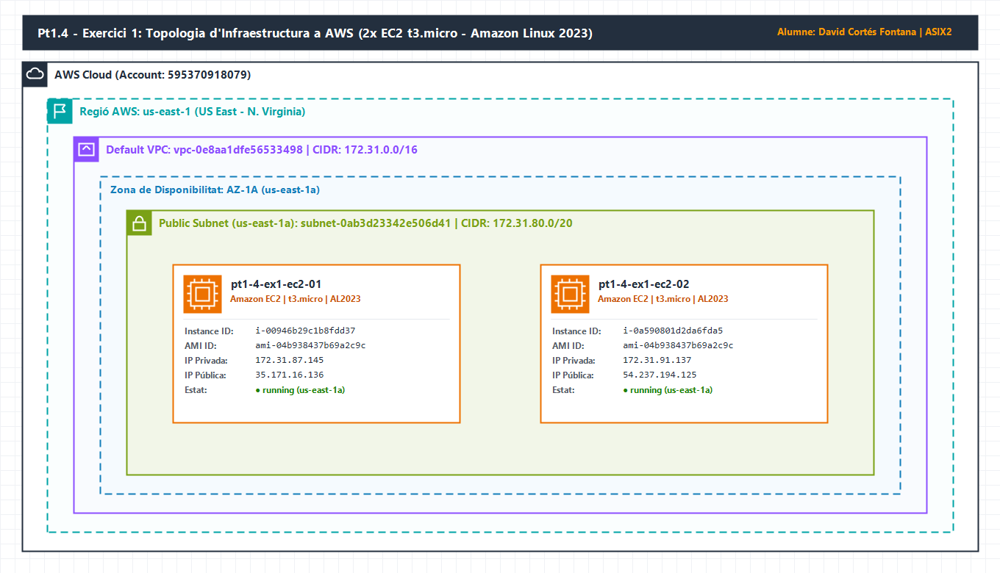

# 🚀 Pt1.4 - Exercici 1: Primeres instàncies EC2 amb Terraform

| Camp | Detall |
| :--- | :--- |
| **Centre** | INS Provençana — Departament d'Informàtica |
| **Mòdul** | Cloud Computing (ASIX2 — Curs 2026-2027) |
| **Professors** | Pedro Durán i Joan Muñoz |
| **Alumne** | David Cortés Fontana |
| **Pràctica** | Control Pt1.4 — Exercici 1 |
| **Regió AWS** | `us-east-1` (US East - N. Virginia) |

---

## 🎯 Objectiu

Iniciar-se en la **Infraestructura com a Codi (IaC)** utilitzant **Terraform** per automatitzar la definició, el desplegament i la gestió del cicle de vida de recursos de còmput bàsics (instàncies Amazon EC2) a Amazon Web Services (AWS).

---

## 🗺️ Diagrama de la Topologia de Xarxa

El següent diagrama (dissenyat amb **draw.io** utilitzant la iconografia oficial d'AWS) il·lustra l'arquitectura desplegada a la regió `us-east-1` dins de la VPC per defecte del compte i la zona de disponibilitat `us-east-1a`:



> 💡 El fitxer font editable del diagrama es troba disponible a [`./assets/topologia.drawio`](./assets/topologia.drawio).

---

## 📋 Especificacions dels Recursos Desplegats

| Paràmetre | Valor Configurat / Desplegat |
| :--- | :--- |
| **Proveïdor Cloud** | Amazon Web Services (AWS) — Compte `595370918079` |
| **Regió d'AWS** | `us-east-1` (N. Virginia) |
| **Zona de Disponibilitat (AZ)** | `us-east-1a` |
| **VPC (per defecte)** | `vpc-0e8aa1dfe56533498` (`172.31.0.0/16`) |
| **Subxarxa utilitzada** | `subnet-0ab3d23342e506d41` (`172.31.80.0/20`) |
| **Sistema Operatiu (AMI)** | Amazon Linux 2023 (`ami-04b938437b69a2c9c`, x86_64, HVM) |
| **Tipus d'instància EC2** | `t3.micro` (2 vCPU, 1 GiB RAM) |
| **Nombre d'instàncies** | `2` (`pt1-4-ex1-ec2-01` i `pt1-4-ex1-ec2-02`) |

### Resum de les Instàncies EC2 Creades

| Nom (Tag `Name`) | Instance ID | Tipus | Zona (AZ) | IP Privada | IP Pública | Estat |
| :--- | :--- | :--- | :--- | :--- | :--- | :--- |
| `pt1-4-ex1-ec2-01` | `i-00946b29c1b8fdd37` | `t3.micro` | `us-east-1a` | `172.31.87.145` | `35.171.16.136` | `running` |
| `pt1-4-ex1-ec2-02` | `i-0a590801d2da6fda5` | `t3.micro` | `us-east-1a` | `172.31.91.137` | `54.237.194.125` | `running` |

---

## 📁 Estructura d'Arxius de l'Exercici

```text
pt1-4-ex1/
├── assets/
│   ├── topologia.drawio   # Fitxer font del diagrama de xarxa (draw.io)
│   └── topologia.png      # Exportació PNG de la topologia d'AWS
├── README.md              # Documentació pas a pas de l'exercici
├── main.tf                # Definició del proveïdor, data sources i instàncies EC2
├── variables.tf           # Variables d'entrada parametritzades amb validació
└── outputs.tf             # Valors de sortida (IDs, AMI i adreces IP)
```

---

## 🔧 Explicació Pas a Pas del Procediment Realitzat

### Pas 1: Configuració de les credencials d'AWS CLI
S'han configurat les credencials temporals d'AWS Academy (`aws_access_key_id`, `aws_secret_access_key` i `aws_session_token`) al fitxer `~/.aws/credentials` sota el perfil `[default]`, verificant la identitat amb:
```bash
aws sts get-caller-identity --region us-east-1
```

### Pas 2: Disseny modular del codi Terraform
Per garantir un codi net, reutilitzable i sense valors *hardcoded*, el projecte s'ha estructurat en tres fitxers:
1. **[`variables.tf`](./variables.tf)**: Defineix les variables `aws_region` (`us-east-1`), `availability_zone` (`us-east-1a`), `instance_type` (`t3.micro`), `instance_count` (`2`) i `project_name` (`pt1-4-ex1`), incloent una regla de validació (`validation`) per assegurar que el nombre d'instàncies sigui positiu.
2. **[`main.tf`](./main.tf)**:
   - Configura el bloc `terraform` exigint la versió `>= 1.5.0` i el proveïdor oficial `hashicorp/aws` (`~> 5.0`).
   - Utilitza el *data source* `data "aws_ami" "amazon_linux_2023"` amb filtres (`al2023-ami-2023.*-x86_64`, arquitectura `x86_64` i virtualització `hvm`) per consultar dinàmicament l'AMI oficial més recent d'Amazon Linux 2023 a `us-east-1` (`ami-04b938437b69a2c9c`).
   - Consulta la VPC per defecte (`data "aws_vpc" "default"`) i la subxarxa per defecte de `us-east-1a` (`data "aws_subnet" "default_az"`).
   - Desplega les 2 instàncies mitjançant `resource "aws_instance" "ec2_nodes"` utilitzant el meta-argument `count = var.instance_count` i etiquetant cada node de forma dinàmica (`pt1-4-ex1-ec2-01` i `pt1-4-ex1-ec2-02`).
3. **[`outputs.tf`](./outputs.tf)**: Exposa en finalitzar el desplegament l'ID de l'AMI, la VPC, la subxarxa i un mapa resum (`instances_summary`) amb l'ID, l'AZ i les IPs privades i públiques de les dues instàncies.

---

## 💻 Instruccions d'Execució de Terraform

Situa't dins del directori de l'exercici:
```bash
cd pt1-4-ex1
```

### 1. Inicialització del projecte (`terraform init`)
Descarrega i instal·la el connector del proveïdor `hashicorp/aws`:
```bash
terraform init
```

### 2. Validació i previsualització del pla (`terraform plan`)
Comprova la sintaxi del codi i mostra els recursos que Terraform crearà a AWS abans d'aplicar cap canvi:
```bash
terraform validate
terraform plan
```

### 3. Creació de la infraestructura (`terraform apply`)
Executa el desplegament real de les 2 instàncies EC2 a `us-east-1`:
```bash
terraform apply -auto-approve
```

**Sortida real obtinguda durant l'execució:**
```hcl
Apply complete! Resources: 2 added, 0 changed, 0 destroyed.

Outputs:

ami_id = "ami-04b938437b69a2c9c"
default_vpc_id = "vpc-0e8aa1dfe56533498"
instances_summary = {
  "pt1-4-ex1-ec2-01" = {
    "availability_zone" = "us-east-1a"
    "id"                = "i-00946b29c1b8fdd37"
    "instance_type"     = "t3.micro"
    "private_ip"        = "172.31.87.145"
    "public_ip"         = "35.171.16.136"
  }
  "pt1-4-ex1-ec2-02" = {
    "availability_zone" = "us-east-1a"
    "id"                = "i-0a590801d2da6fda5"
    "instance_type"     = "t3.micro"
    "private_ip"        = "172.31.91.137"
    "public_ip"         = "54.237.194.125"
  }
}
subnet_id = "subnet-0ab3d23342e506d41"
```

### 4. Destrucció de la infraestructura (`terraform destroy`)
Un cop verificat el funcionament, per eliminar tots els recursos creats i evitar costos innecessaris al compte d'AWS:
```bash
terraform destroy -auto-approve
```
