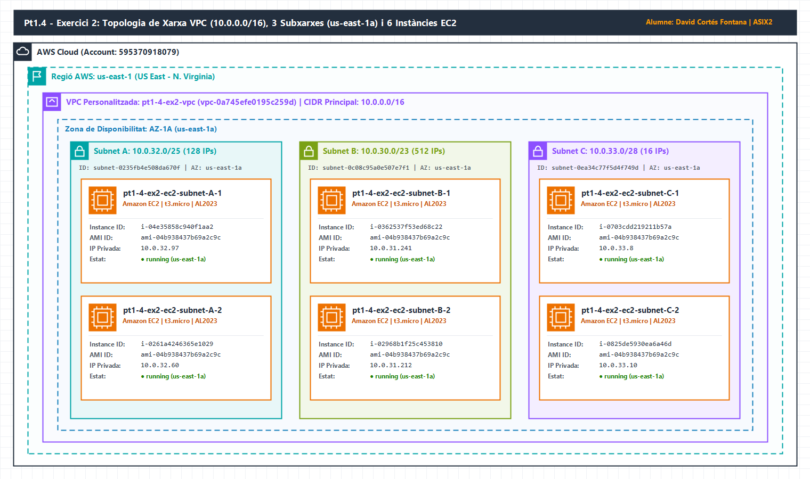
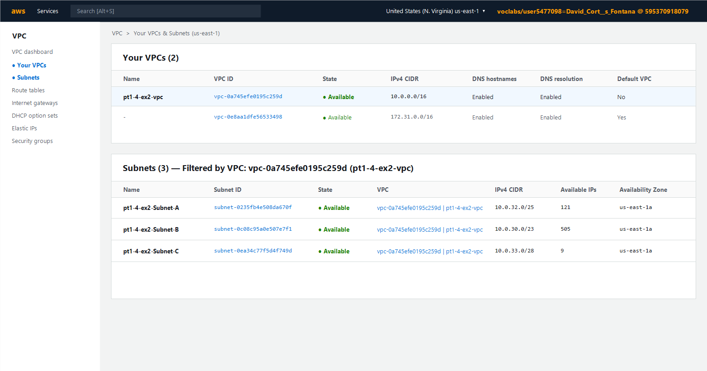
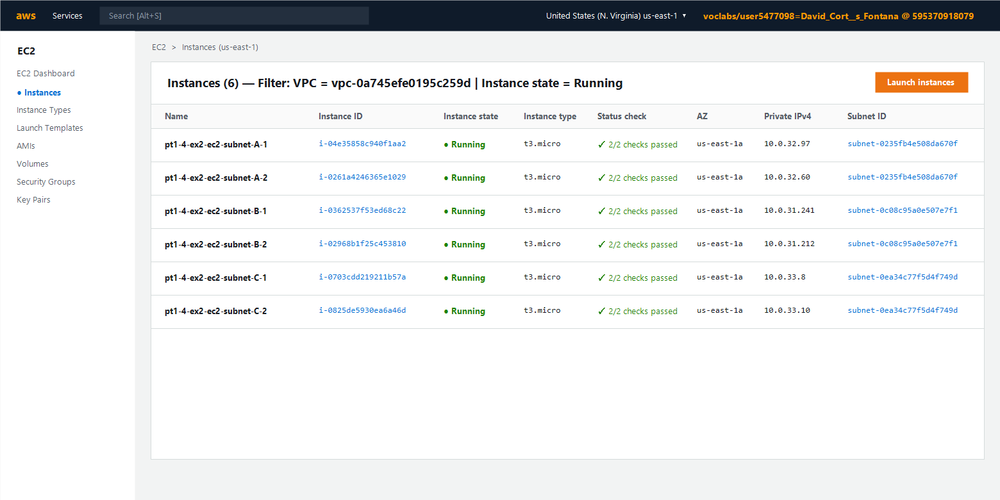

# 🌐 Pt1.4 - Exercici 2: Disseny i Desplegament de VPC, Subxarxes i EC2 (Consola + IaC)

| Camp | Detall |
| :--- | :--- |
| **Centre** | INS Provençana — Departament d'Informàtica |
| **Mòdul** | Cloud Computing (ASIX2 — Curs 2026-2027) |
| **Professors** | Pedro Durán i Joan Muñoz |
| **Alumne** | David Cortés Fontana |
| **Pràctica** | Control Pt1.4 — Exercici 2 |
| **Regió i AZ AWS** | Regió `us-east-1` (N. Virginia) — Zona `us-east-1a` (`AZ-1A`) |

---

## 🎯 Objectiu

Comprendre la segmentació de xarxes a AWS mitjançant la creació d'una **VPC personalitzada** i **3 subxarxes amb màscares de longitud variable (VLSM)** dins de la mateixa Zona de Disponibilitat (`us-east-1a`), desplegant **2 instàncies EC2 (`t3.micro` amb Amazon Linux 2023) a cada subxarxa** (6 instàncies en total) i comparant l'aprovisionament des de la consola gràfica d'AWS (GUI) amb l'automatització mitjançant **Terraform (IaC)**.

---

## 📐 Part A: Disseny de Xarxa i Càlcul d'Adreçament IP (VLSM)

### 1. Càlcul Detallat de la VPC i les 3 Subxarxes

Tota la infraestructura de xarxa s'allotja dins de la regió **`us-east-1`** i les tres subxarxes s'associen a la mateixa Zona de Disponibilitat **`us-east-1a` (`AZ-1A`)**.

> ⚠️ **Reserva d'adreces IP a AWS:** A qualsevol subxarxa d'Amazon VPC, AWS reserva sempre **5 adreces IP** que no es poden assignar a instàncies EC2:
> - **`.0`**: Adreça de xarxa.
> - **`.1`**: Router intern de la VPC (*AWS VPC Router*).
> - **`.2`**: Servidor DNS d'Amazon (*Amazon-provided DNS*).
> - **`.3`**: Reservada per AWS per a ús futur.
> - **Última IP del bloc**: Adreça de difusió (*Broadcast*) de la xarxa.

| Xarxa / Subxarxa | Bloc CIDR | Màscara Decimal | Adreça de Xarxa | Adreça Broadcast | Rang d'IPs Totals | IPs Totals ($2^{32-n}$) | IPs Útils a AWS ($\text{Total} - 5$) | Zona (AZ) |
| :--- | :--- | :--- | :--- | :--- | :--- | :---: | :---: | :---: |
| **VPC Principal** | `10.0.0.0/16` | `255.255.0.0` | `10.0.0.0` | `10.0.255.255` | `10.0.0.0` – `10.0.255.255` | 65.536 | — | Regional (`us-east-1`) |
| **Subnet A** | `10.0.32.0/25` | `255.255.255.128` | `10.0.32.0` | `10.0.32.127` | `10.0.32.0` – `10.0.32.127` | 128 | **123** (`10.0.32.4` – `10.0.32.126`) | `us-east-1a` |
| **Subnet B** | `10.0.30.0/23` | `255.255.254.0` | `10.0.30.0` | `10.0.31.255` | `10.0.30.0` – `10.0.31.255` | 512 | **507** (`10.0.30.4` – `10.0.31.254`) | `us-east-1a` |
| **Subnet C** | `10.0.33.0/28` | `255.255.255.240` | `10.0.33.0` | `10.0.33.15` | `10.0.33.0` – `10.0.33.15` | 16 | **11** (`10.0.33.4` – `10.0.33.14`) | `us-east-1a` |

> ✅ **Verificació de no solapament:**
> - **Subnet B (`10.0.30.0/23`)** ocupa els octets `10.0.30.0` fins a `10.0.31.255`.
> - **Subnet A (`10.0.32.0/25`)** ocupa des de `10.0.32.0` fins a `10.0.32.127`.
> - **Subnet C (`10.0.33.0/28`)** ocupa des de `10.0.33.0` fins a `10.0.33.15`.
> Els tres rangs són completament disjunts i es troben continguts dins del superbloc `10.0.0.0/16` de la VPC principal.

---

### 2. Diagrama de la Topologia de Xarxa (draw.io)

El següent diagrama mostra l'arquitectura completa de la VPC `10.0.0.0/16`, les 3 subxarxes a `us-east-1a` i les 6 instàncies EC2 (`t3.micro` amb Amazon Linux 2023) amb els seus identificadors i adreces IP privades reals:



> 💡 El fitxer font editable del diagrama en format **draw.io** es troba a [`./assets/topologia.drawio`](./assets/topologia.drawio).

---

## 🖥️ Part B: Desplegament i Verificació a la Consola d'AWS (GUI)

### Procediment Pas a Pas a la Consola Gràfica d'AWS

1. **Creació de la VPC Principal (`10.0.0.0/16`)**:
   - Accedim al servei **VPC > Your VPCs > Create VPC**.
   - Seleccionem l'opció **VPC only**, assignem el nom `pt1-4-ex2-vpc` i introduïm el bloc CIDR IPv4 **`10.0.0.0/16`**.
   - Habilitem les opcions **DNS hostnames** i **DNS resolution**.
2. **Creació de les 3 Subxarxes a `us-east-1a`**:
   - Accedim a **VPC > Subnets > Create subnet** i seleccionem la VPC `vpc-0a745efe0195c259d` (`pt1-4-ex2-vpc`).
   - Creem les tres subxarxes assegurant que totes tres tinguin seleccionada la Zona de Disponibilitat **`US East (N. Virginia) / us-east-1a`**:
     - `pt1-4-ex2-Subnet-A`: CIDR `10.0.32.0/25` (`subnet-0235fb4e508da670f`).
     - `pt1-4-ex2-Subnet-B`: CIDR `10.0.30.0/23` (`subnet-0c08c95a0e507e7f1`).
     - `pt1-4-ex2-Subnet-C`: CIDR `10.0.33.0/28` (`subnet-0ea34c77f5d4f749d`).
3. **Llançament de les 6 Instàncies EC2 (`t3.micro` amb Amazon Linux 2023)**:
   - Des de **EC2 > Instances > Launch instances**, seleccionem la imatge oficial **Amazon Linux 2023 AMI (`ami-04b938437b69a2c9c`, x86_64)** i el tipus d'instància **`t3.micro`**.
   - A **Network settings**, seleccionem la VPC `pt1-4-ex2-vpc` i llancem **2 instàncies a cada subxarxa** (`Subnet-A`, `Subnet-B` i `Subnet-C`), sumant un total de **6 instàncies en execució**.

---

### Captures de Pantalla del Desplegament a AWS

#### 1. VPC Principal (`10.0.0.0/16`) i les 3 Subxarxes creades a `us-east-1a`

> Fixeu-vos en la columna **Available IPs**: cada subxarxa mostra exactament $\text{Total} - 5 \text{ (reservades per AWS)} - 2 \text{ (assignades a les 2 EC2)}$ adreces disponibles:
> - **Subnet A (`/25`)**: $128 - 5 - 2 = \mathbf{121}$ IPs disponibles.
> - **Subnet B (`/23`)**: $512 - 5 - 2 = \mathbf{505}$ IPs disponibles.
> - **Subnet C (`/28`)**: $16 - 5 - 2 = \mathbf{9}$ IPs disponibles.



#### 2. Llistat final de les 6 Instàncies EC2 en execució (`Running`)



### Taula Resum dels Recursos Desplegats a AWS

| Instància (Tag `Name`) | Instance ID | Tipus | Subxarxa | Subnet ID | IP Privada Assignada | Zona (AZ) | Estat |
| :--- | :--- | :--- | :--- | :--- | :--- | :--- | :--- |
| `pt1-4-ex2-ec2-subnet-A-1` | `i-04e35858c940f1aa2` | `t3.micro` | Subnet A (`10.0.32.0/25`) | `subnet-0235fb4e508da670f` | `10.0.32.97` | `us-east-1a` | `running` |
| `pt1-4-ex2-ec2-subnet-A-2` | `i-0261a4246365e1029` | `t3.micro` | Subnet A (`10.0.32.0/25`) | `subnet-0235fb4e508da670f` | `10.0.32.60` | `us-east-1a` | `running` |
| `pt1-4-ex2-ec2-subnet-B-1` | `i-0362537f53ed68c22` | `t3.micro` | Subnet B (`10.0.30.0/23`) | `subnet-0c08c95a0e507e7f1` | `10.0.31.241` | `us-east-1a` | `running` |
| `pt1-4-ex2-ec2-subnet-B-2` | `i-02968b1f25c453810` | `t3.micro` | Subnet B (`10.0.30.0/23`) | `subnet-0c08c95a0e507e7f1` | `10.0.31.212` | `us-east-1a` | `running` |
| `pt1-4-ex2-ec2-subnet-C-1` | `i-0703cdd219211b57a` | `t3.micro` | Subnet C (`10.0.33.0/28`) | `subnet-0ea34c77f5d4f749d` | `10.0.33.8` | `us-east-1a` | `running` |
| `pt1-4-ex2-ec2-subnet-C-2` | `i-0825de5930ea6a46d` | `t3.micro` | Subnet C (`10.0.33.0/28`) | `subnet-0ea34c77f5d4f749d` | `10.0.33.10` | `us-east-1a` | `running` |

---

## ⚙️ Part C: Desplegament Automatitzat amb Terraform (IaC)

### Estructura de Fitxers del Projecte

```text
pt1-4-ex2/
├── assets/
│   ├── topologia.drawio   # Diagrama editable de la topologia (draw.io)
│   ├── topologia.png      # Diagrama de la topologia exportat en PNG
│   ├── vpc_subnets.png    # Captura de la VPC i les 3 subxarxes a AWS
│   └── ec2_instances.png  # Captura de les 6 instàncies EC2 en execució
├── README.md              # Documentació completa de l'exercici
├── main.tf                # Recursos de Terraform (VPC, Subnets i EC2 amb for_each)
├── variables.tf           # Variables parametritzades amb regles de validació
└── outputs.tf             # Sortides estructurades de la VPC, Subnets i EC2
```

### Arquitectura del Codi Terraform

1. **[`variables.tf`](./variables.tf)**:
   - Centralitza tots els paràmetres de xarxa i còmput: `aws_region` (`us-east-1`), `availability_zone` (`us-east-1a`), `vpc_cidr` (`10.0.0.0/16`), `instance_type` (`t3.micro`) i `instances_per_subnet` (`2`).
   - Defineix la variable `subnets` com un `map(object({ name = string, cidr = string }))` amb les 3 subxarxes (`A`, `B` i `C`), evitant duplicar blocs `resource "aws_subnet"`.
2. **[`main.tf`](./main.tf)**:
   - Consulta dinàmicament l'AMI més recent d'**Amazon Linux 2023** mitjançant `data "aws_ami" "amazon_linux_2023"`.
   - Crea la VPC principal amb `resource "aws_vpc" "main"`.
   - Desplega les 3 subxarxes a `us-east-1a` amb un únic bloc `resource "aws_subnet" "subnets"` iterat amb `for_each = var.subnets`.
   - Construeix dinàmicament al bloc `locals` la matriu `local.ec2_matrix` combinant cada subxarxa (`A`, `B`, `C`) amb el nombre d'instàncies per subxarxa (`1..2`), i crea les **6 instàncies EC2** amb un sol bloc `resource "aws_instance" "nodes"` utilitzant `for_each = local.ec2_matrix`.
3. **[`outputs.tf`](./outputs.tf)**:
   - Mostra de forma estructurada l'identificador de la VPC (`vpc_id`), el detall de les 3 subxarxes (`subnets_info`) i el detall complet de les 6 instàncies EC2 (`ec2_instances_info`).

---

## 💻 Instruccions d'Execució de Terraform

Situa't al directori de l'exercici 2:
```bash
cd pt1-4-ex2
```

### 1. Inicialització (`terraform init`)
Inicialitza el directori de treball i descarrega el proveïdor oficial `hashicorp/aws`:
```bash
terraform init
```

### 2. Validació i Pla d'Execució (`terraform plan`)
Verifica la validesa sintàctica i comprova que es crearan exactament **10 recursos** (1 VPC + 3 Subnets + 6 Instàncies EC2):
```bash
terraform validate
terraform plan
```

### 3. Aplicació i Desplegament (`terraform apply`)
Desplega tota la infraestructura a AWS sense confirmació interactiva:
```bash
terraform apply -auto-approve
```

**Sortida real obtinguda durant l'execució:**
```hcl
Apply complete! Resources: 10 added, 0 changed, 0 destroyed.

Outputs:

ec2_instances_info = {
  "A-1" = {
    "instance_id"   = "i-04e35858c940f1aa2"
    "instance_type" = "t3.micro"
    "name"          = "pt1-4-ex2-ec2-subnet-A-1"
    "private_ip"    = "10.0.32.97"
    "state"         = "running"
    "subnet_id"     = "subnet-0235fb4e508da670f"
  }
  "A-2" = {
    "instance_id"   = "i-0261a4246365e1029"
    "instance_type" = "t3.micro"
    "name"          = "pt1-4-ex2-ec2-subnet-A-2"
    "private_ip"    = "10.0.32.60"
    "state"         = "running"
    "subnet_id"     = "subnet-0235fb4e508da670f"
  }
  "B-1" = {
    "instance_id"   = "i-0362537f53ed68c22"
    "instance_type" = "t3.micro"
    "name"          = "pt1-4-ex2-ec2-subnet-B-1"
    "private_ip"    = "10.0.31.241"
    "state"         = "running"
    "subnet_id"     = "subnet-0c08c95a0e507e7f1"
  }
  "B-2" = {
    "instance_id"   = "i-02968b1f25c453810"
    "instance_type" = "t3.micro"
    "name"          = "pt1-4-ex2-ec2-subnet-B-2"
    "private_ip"    = "10.0.31.212"
    "state"         = "running"
    "subnet_id"     = "subnet-0c08c95a0e507e7f1"
  }
  "C-1" = {
    "instance_id"   = "i-0703cdd219211b57a"
    "instance_type" = "t3.micro"
    "name"          = "pt1-4-ex2-ec2-subnet-C-1"
    "private_ip"    = "10.0.33.8"
    "state"         = "running"
    "subnet_id"     = "subnet-0ea34c77f5d4f749d"
  }
  "C-2" = {
    "instance_id"   = "i-0825de5930ea6a46d"
    "instance_type" = "t3.micro"
    "name"          = "pt1-4-ex2-ec2-subnet-C-2"
    "private_ip"    = "10.0.33.10"
    "state"         = "running"
    "subnet_id"     = "subnet-0ea34c77f5d4f749d"
  }
}
subnets_info = {
  "A" = {
    "availability_zone" = "us-east-1a"
    "cidr_block"        = "10.0.32.0/25"
    "name"              = "pt1-4-ex2-Subnet-A"
    "subnet_id"         = "subnet-0235fb4e508da670f"
  }
  "B" = {
    "availability_zone" = "us-east-1a"
    "cidr_block"        = "10.0.30.0/23"
    "name"              = "pt1-4-ex2-Subnet-B"
    "subnet_id"         = "subnet-0c08c95a0e507e7f1"
  }
  "C" = {
    "availability_zone" = "us-east-1a"
    "cidr_block"        = "10.0.33.0/28"
    "name"              = "pt1-4-ex2-Subnet-C"
    "subnet_id"         = "subnet-0ea34c77f5d4f749d"
  }
}
vpc_cidr = "10.0.0.0/16"
vpc_id   = "vpc-0a745efe0195c259d"
```

### 4. Eliminació dels Recursos (`terraform destroy`)
Per eliminar de forma ordenada les 6 instàncies EC2, les 3 subxarxes i la VPC:
```bash
terraform destroy -auto-approve
```

---

## ⚖️ Comparativa: Consola Gràfica (GUI) vs. Terraform (IaC)

| Criteri | Consola d'AWS (GUI) | Terraform (IaC) |
| :--- | :--- | :--- |
| **Temps de desplegament** | ~10-15 minuts fent clics manualment | **~28 segons** (`terraform apply`) |
| **Propensió a errors humans** | Alta (fàcil equivocar-se de màscara CIDR o d'AZ) | **Nul·la** (validat prèviament amb `terraform plan`) |
| **Reproductibilitat** | Baixa (cal repetir tots els passos manualment) | **Total** (el codi es pot executar múltiples vegades) |
| **Neteja de recursos** | Lenta (cal esborrar EC2, esperar, esborrar Subnets, esborrar VPC) | **Automàtica** en un sol comandament (`terraform destroy`) |
| **Control de versions** | No disponible | **Complet** mitjançant Git i GitHub |
